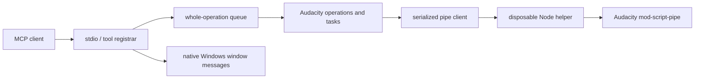

# Architecture

The server is a local stdio process. Runtime dependencies are the official MCP
SDK v2 and zod. Audacity remains the audio editor and processor; Node provides
validation, orchestration and bounded audio measurement.

| Area | Location |
| --- | --- |
| Entry, doctor, server assembly | `src/main.ts`, `src/doctor.ts`, `src/server.ts` |
| Tool boundaries and metadata | `src/tools.ts`, `src/tool-*.ts` |
| Native process/window/config lifecycle | `src/app.ts`, `src/app-*.ts` |
| Pipe transport and byte codec | `src/pipe.ts`, `src/pipe-worker.ts`, `src/format.ts` |
| Catalogue and native effect policy | `src/catalogue.ts`, `src/catalogue-bounds.ts`, `src/effect-safety.ts`, `catalogue/` |
| Selection, tracks, imports, noise state | `src/ops.ts`, `src/audacity/` |
| Plans and editing tasks | `src/tasks.ts`, `src/tasks/`, `src/batch.ts` |
| Analysis and rendered transactions | `src/analysis.ts`, `src/analysis/`, `src/source-rate.ts` |
| Labels, transport, macros/preferences | `src/labels.ts`, `src/controls.ts` and domain modules |

The whole-operation queue protects selection-dependent sequences. Pipe
exchanges also serialize independently. Dialog/window controls bypass that
queue because a blocked command must not prevent native dialog closure.

Every tool has a title and conservative annotations. Object data reports add
output schemas and structured content matching their legacy JSON text exactly.
Array/string results retain text-only compatibility. Pipelines and batches
send request-token progress for completed stages. SDK-supported protocol
revisions negotiate normally; no latest-only override is applied.
